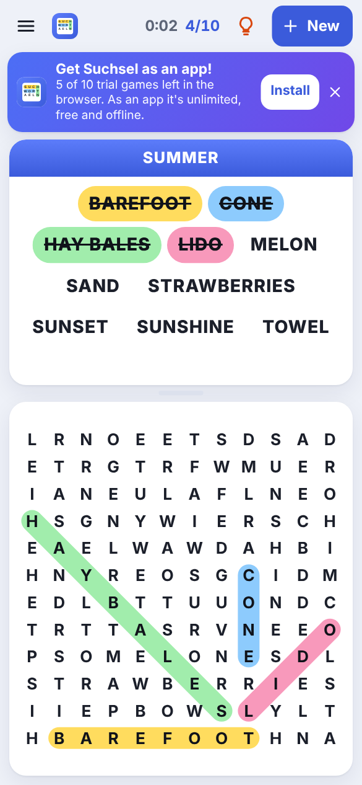
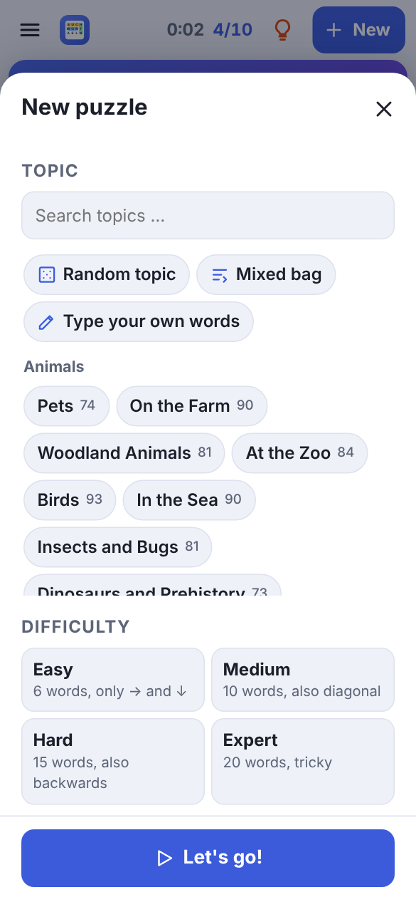
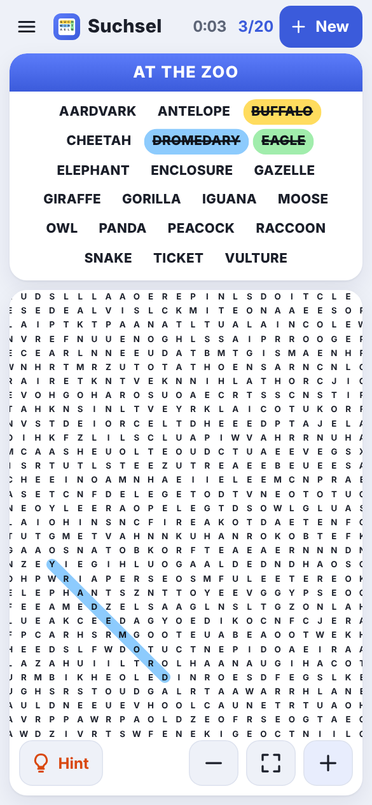
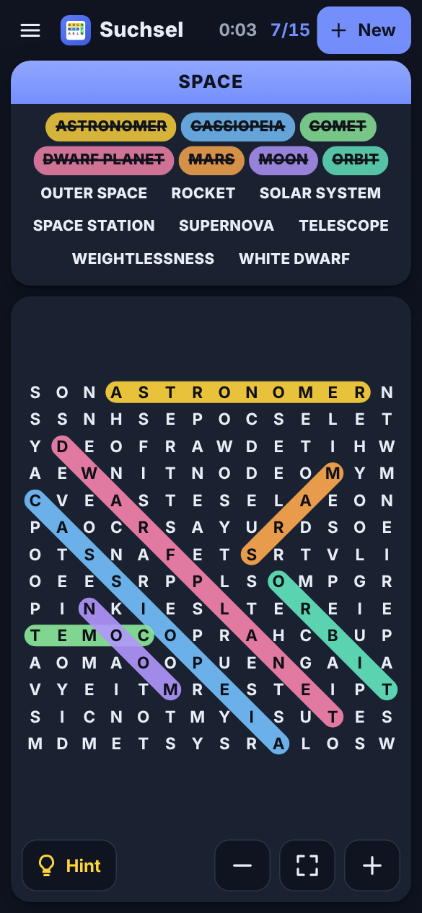
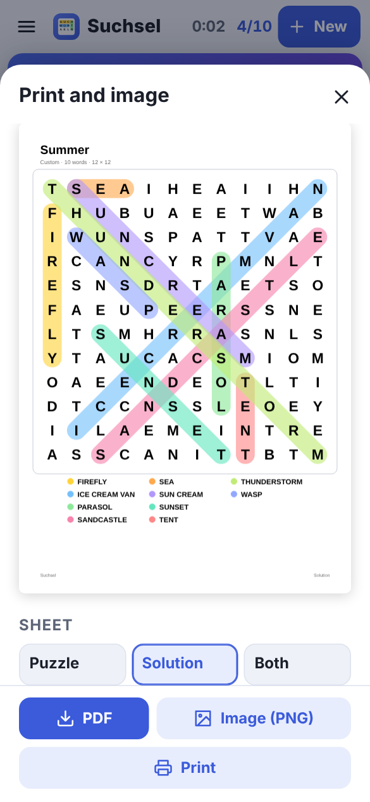
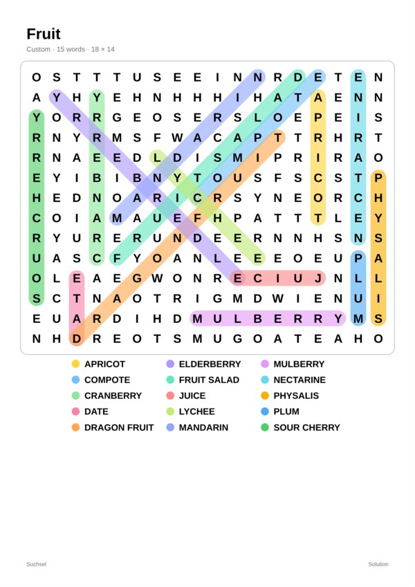
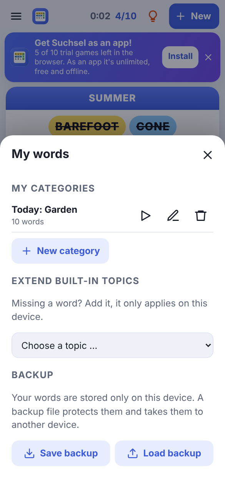
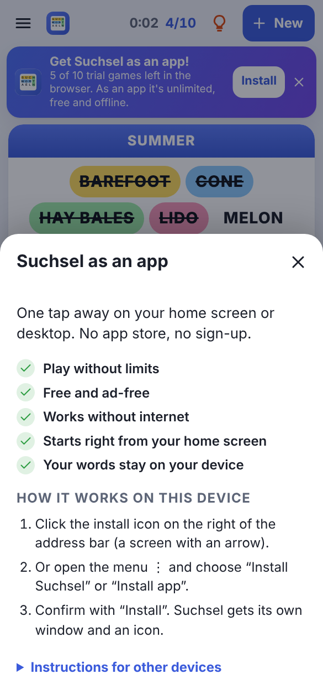
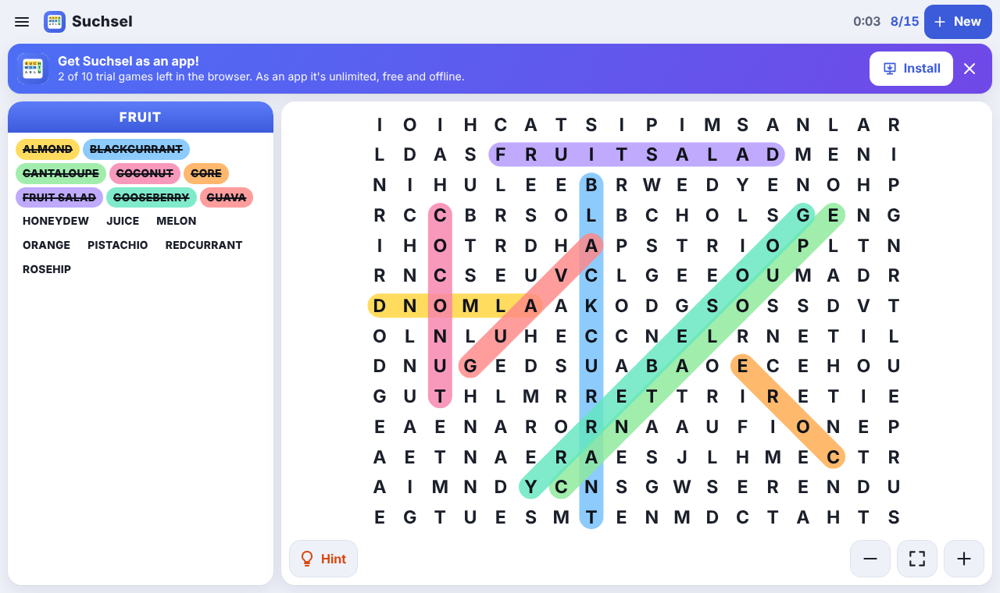

# Suchsel

[Deutsch](README.md) · **English**

[](#requirements)
[](#license)
[](https://ko-fi.com/burnersen)

## 🎮 [Play now: suchsel.burnersen.de](https://suchsel.burnersen.de)

**Free for everyone, no sign-up and no ads.** Just try it in your browser and, if you like it, install it as an app on your phone, tablet or computer with one click. No web hosting of your own needed.

If you prefer to run Suchsel on your own server, feel free: **[⬇️ Download the latest release](../../releases/latest)**, see [Installation](#installation).

**[☕ Buy me a coffee](https://ko-fi.com/burnersen)**

<p align="center">
  <a href="promo/suchsel-promo.mp4"></a><br>
  <sub>🎬 Suchsel in one minute (German captions) · <a href="promo/suchsel-promo.mp4">Video as MP4, for sharing</a></sub>
</p>

Word search puzzles as a self-hosted app. Mark words with your finger or the mouse, zoom in, type your own words and print A4 PDFs. With more than 26,000 words in six languages. The server runs PHP, the browser plain JavaScript and CSS. No frameworks, no dependencies, no build step, no MySQL.

The app is loaded from the server once and then runs entirely on the device, even without internet. Anyone opening the website in a browser may try a few puzzles (10 by default). After that they keep playing for free and without limits in the installed app. A banner at the top invites them to do so on every visit.

Upload `suchsel-install.php`, open it in the browser, click "Install now". That is the whole installation. New versions are installed automatically afterwards.

<p align="center">
  
</p>

<table>
  <tr>
    <td align="center" width="33%"><br><sub>Choose topic and difficulty</sub></td>
    <td align="center" width="33%"><br><sub>Large grid with zoom</sub></td>
    <td align="center" width="33%"><br><sub>Dark theme, round font</sub></td>
  </tr>
  <tr>
    <td align="center"><br><sub>Printing with preview</sub></td>
    <td align="center"><br><sub>The solution sheet</sub></td>
    <td align="center"><br><sub>Your own categories</sub></td>
  </tr>
  <tr>
    <td align="center"><br><sub>How to install</sub></td>
    <td align="center" colspan="2"><br><sub>On a computer: word list on the left, grid on the right</sub></td>
  </tr>
</table>

<sub>Screenshots of version 1.0.0.</sub>

> 💜 **Do you like Suchsel?** A ⭐ on GitHub is the easiest way to tell me. Or [tell me what you use it for](https://github.com/burnersen/suchsel/issues/new), I read every message. Thank you!

## Contents

[How to play](#how-to-play) · [Features](#features) · [Requirements](#requirements) · [Installation](#installation) · [Server settings](#server-settings) · [Updates](#updates) · [Privacy and security](#privacy-and-security) · [Structure](#structure) · [Extending the vocabulary](#extending-the-vocabulary) · [Good to know](#good-to-know) · [License](#license)

## How to play

1. **Find words:** the words to find are at the top. Swipe your finger or drag the mouse across the letters of a word. The marker snaps horizontally, vertically and diagonally, whether you start at the front or the back, and keeps its direction when your finger wobbles a little.
2. **Found:** the word gets its own colour, in the grid and in the list at the top, where it is crossed out. Crossing words stay easy to tell apart. Tapping it in the list shows the word in the grid again.
3. **Done:** confetti, time and best time. Then straight to the next puzzle, another topic or print the solution sheet.

| Action | On a phone | On a computer |
|---|---|---|
| Mark a word | swipe across it | drag across it with the mouse |
| Zoom | spread or pinch two fingers | mouse wheel, Ctrl + wheel, keys + and − |
| Move | move two fingers together | hold the right mouse button, mouse wheel, arrow keys |
| Back to starting size | double tap | double click or key 0 |
| Word list bigger or smaller | drag the bar between list and grid, double tap resets it | same |
| Word list at the top, bottom, left or right | Menu, Settings, Word list | same |
| Hint | light bulb at the top | same |
| Flashlight | drag your finger across the grid | move the mouse over the grid |

When you mark near the edge, the grid moves along by itself, so long words work in large grids too. Once the direction is set, it moves exactly along the word, so for diagonal words sideways and up or down at the same time. The split between word list and grid adapts to the shape of the grid, and the word list uses the largest font that fits. If you drag the list smaller, the text shrinks and the words already found collapse into a small ✓ that expands them again when tapped. If there is still not enough room, the text stays readable and the list can be swiped: sideways at the top and bottom, up and down on the left and right. Text cannot be selected by accident.

## Features

### Puzzles

- **Any grid size:** width and height separately, from 5 to 100. Small grids fit the whole screen, large ones start at a readable size and can be zoomed.
- **Difficulty:** Easy (6 words, only → and ↓), Medium (10 words, also diagonal), Hard (15 words, also backwards), Expert (20 words in all directions with tricky filler letters). Fine tuning lets you set everything yourself: 5 to 20 words, size, directions (across, down, diagonal, backwards), tricky filler letters.
- **Like a real word search:** the words spread across the whole grid instead of clumping in one corner, rarely lie side by side in parallel and run in mixed directions. They still cross now and then. Filler letters follow the letter frequency of the language. No word appears twice by accident, and no word hides inside another one.
- **Special letters:** Ä, Ö, Ü (and Ñ in Spanish) stay in the grid, or are replaced by AE, OE, UE if you like. ß always becomes SS, accents are dropped. Spaces and hyphens disappear: "ice cream" is ICECREAM in the grid and ICE CREAM in the list.
- **Reshuffle:** same words, new grid.
- **Hint:** shows where one of the words starts.
- **Flashlight:** can be switched on for a new puzzle. The grid lies in the dark, only the letters around your finger or the mouse light up, with a trail of light that glows on for almost a second. The harder the puzzle, the smaller the light (Easy large, Medium medium, Hard and Expert small). Found words stay visible, and once everything is found the light comes on. Best times with the flashlight are counted separately.
- **Word list where you want it:** top, bottom, left, right or automatic (top in portrait, left on wide screens).
- **Timer and statistics:** puzzles started and solved, words found, hints, playing time and best times per difficulty. The timer only runs while the puzzle is visible.
- **Progress is kept:** close the app, open it again, carry on.
- **Share via link:** whoever opens the link gets exactly the same grid. The link only contains the words and settings, no solutions.

### Vocabulary

More than 26,000 words, sorted into topics and groups (animals, food and drink, nature, seasons and holidays, people, home, out and about, world, free time, fantasy and history, technology):

| Language | Topics | Words |
|---|---|---|
| Deutsch | 69 | 5,406 |
| English | 69 | 5,522 |
| Français | 53 | 3,858 |
| Español | 53 | 3,844 |
| Italiano | 53 | 3,879 |
| Nederlands | 53 | 4,054 |

- **Search** across all topics, plus "Random topic" and "Mixed bag" (words from all topics).
- **The language of the words** can be chosen separately from the app language, e.g. for language learning: English interface, German words.
- Latin letters only, no other scripts.

### Your own words

- **Quick entry:** in "New puzzle" type a title and a few words, separated by commas or line breaks, done. Ideal for today's topic. The grid grows by itself if a word is too long.
- **Your own categories** under Menu → My words: create, edit, delete. A category with up to 20 words goes into the puzzle completely, larger ones are sampled.
- **Extend built-in topics:** a missing word can be added, on this device only.
- **Backup file:** save your own words, settings and statistics and load them on another device.

### Print and image

- **A4 as PDF**, created in the browser, without third-party libraries and without network.
- **Puzzle sheet, solution sheet or both** (two pages). On the solution sheet every word is marked in colour, found words in their colour from the game.
- **Portrait or landscape**, your own title, word list below the grid (with tick boxes), optionally a line for name and date.
- **The preview** shows exactly what comes out of the printer and updates instantly. Tap it to enlarge.
- **As an image (PNG)** in high resolution, e.g. for messengers or worksheets.
- On phones, PDF and image go to the printer or another app via "Share", on computers as a download. "Print" opens the PDF in a new tab.
- For very large grids Suchsel tells you how small the letters will be on paper.

### App and website

- **Installable as an app** (PWA) on phones, tablets and computers, with its own icon. No app store, no sign-up.
- **Load once, then offline:** a service worker keeps the whole app including the vocabulary of all languages.
- **Install banner** on every visit in the browser, showing the trial games left ("7 of 10 trial games left"). Clicking "Install" starts the installation where the browser supports it (Chrome, Edge, Android). Otherwise Suchsel shows instructions for the device: iPhone and iPad, Android, Firefox, Safari on Mac, Chrome or Edge on computers.
- **Limit in the browser:** after 10 puzzles (configurable) per address and 30 days, the browser version stops and kindly explains how to install the app. A puzzle in progress can still be finished. The installed app has no limit and never asks the server.
- **Six languages:** German, English, French, Spanish, Italian and Dutch. The app starts in the device language.
- **Light, dark or like the device**, four grid fonts (clean, round, classic, typewriter), optional grid lines.
- **Vibration** on hits (can be turned off), keyboard control on computers.

## Requirements

- PHP 7.4 or newer (8.x recommended).
- The `pdo_sqlite` extension for the limit after a few games in the browser. Without it Suchsel still works, just without the limit.
- For automatic updates: `curl` or `allow_url_fopen`, and outgoing connections must be allowed.
- **HTTPS.** Without HTTPS the app cannot be installed and does not work offline.
- A web server with PHP. **Apache** and LiteSpeed lock the internal folders by themselves via `.htaccess`. **nginx** needs two lines in the configuration, see [Privacy and security](#privacy-and-security).

## Installation

1. Download `suchsel-install.php` from the [latest release](../../releases/latest) and copy it into a directory on the web server, e.g. `/suchsel/`.
2. PHP must be allowed to write to this directory (it creates `index.php`, the folder `app/` and later `data/` there).
3. Open `suchsel-install.php` in the browser and click "Install now". The file unpacks the program, deletes itself and redirects to Suchsel. If the installer reports that it could not delete itself, please delete it by hand.
4. **Check that the internal folders are locked:** open `https://your-address/suchsel/data/config.php` and `https://your-address/suchsel/app/lib/core.php`. Both must show "403 Forbidden" or "404 Not Found".

Done. There are no accounts and no setup.

**Prefer doing it by hand?** The release also contains `suchsel-<version>.zip`. Unpack it and upload the contents of the folder `suchsel/`, i.e. `index.php`, `LICENSE` **and** the folder `app/`.

## Server settings

On the first request Suchsel creates the folder `data/`. `data/config.php` contains a random key and the name of the database. Everything else has defaults and can be added there:

| Entry | Default | Meaning |
|---|---|---|
| `'limit' => 10` | 10 | How many new puzzles an address may start in the browser, then only as an app. `0` turns the limit off. |
| `'days' => 30` | 30 | After this many days the count for an address starts over. |
| `'auto_update' => false` | on | No automatic updates. |
| `'update_url' => ''` | GitHub | Another address for updates, `''` turns them off completely. |
| `'ip_header' => 'HTTP_CF_CONNECTING_IP'` | empty | Only behind a proxy such as Cloudflare: where the real visitor address comes from. |

For example `data/config.php` with 5 trial games (the first two lines inside `return` are already there and stay as they are):

```php
return array (
  'secret' => '…',
  'db' => 'su_….sqlite',
  'limit' => 5,
);
```

Make a copy first and restore it if needed (via SSH in the Suchsel directory):

```sh
# Back up the settings
cp -a data/config.php ~/suchsel-config-$(date +%Y%m%d-%H%M).php

# Edit
nano data/config.php

# Restore (adjust the backup name)
cp -a ~/suchsel-config-YYYYMMDD-HHMM.php data/config.php
```

Without SSH: download `data/config.php` via FTP, keep a copy, edit and upload it again.

## Updates

**Automatically:** at most every 15 minutes Suchsel checks the latest release on GitHub, only after a page has been delivered, so nobody has to wait. If there is a new version, the installer is downloaded, verified by checksum and installed. The running version is saved to `data/update-prev.txt` first. Only program files are replaced, `data/` is never touched. Devices pick up the new version the next time they open the app and show a hint to reload.

PHP must be allowed to overwrite the program files and to make outgoing connections. Turn it off with `'auto_update' => false` in `data/config.php`.

**By hand:** upload the new `suchsel-install.php` and open it.

## Privacy and security

**What stays on the device:** your own words, categories, settings, statistics and the current puzzle. None of it is sent to the server.

**What the server stores:** only in a browser tab, never in the app, Suchsel asks before a new puzzle whether one is still available. For this it stores not the address but a keyed checksum of it, plus a count and two timestamps. After 30 days the entry is deleted. For IPv6 the /64 network counts, which usually belongs to a single connection. Suchsel sets no cookies and loads nothing from third-party servers, no fonts, no scripts, no analytics.

**What goes out:** only the hourly question to GitHub about a new version. No personal data is sent.

**Lock the internal folders.** Under Apache Suchsel creates the necessary `.htaccess` files itself. Under **nginx** these two lines belong in the `server` block. The `^~` makes the lock take precedence over the rule for `.php` files:

```nginx
# Suchsel lives in the folder /suchsel/ here. If it is in the web root, leave out /suchsel.
location ^~ /suchsel/data/ { deny all; }
location ^~ /suchsel/app/  { deny all; }
```

Back up the configuration first, then test and reload:

```sh
# Back up the configuration (path depends on the system, often /etc/nginx/sites-available/)
sudo cp -a /etc/nginx/sites-available/default /etc/nginx/sites-available/default.bak

# Test and reload
sudo nginx -t && sudo systemctl reload nginx

# If something goes wrong: restore and reload
sudo cp -a /etc/nginx/sites-available/default.bak /etc/nginx/sites-available/default && sudo systemctl reload nginx
```

Then repeat the check from [Installation, step 4](#installation). Suchsel needs no direct access to `app/`, CSS, JavaScript and the vocabulary are served through `index.php` too.

Note for your privacy policy: the trial counter briefly processes the IP address to compute the checksum. If you do not want the limit, turn it off with `'limit' => 0`, then Suchsel stores nothing at all.

## Structure

```
index.php      entry point: serves files, service worker, manifest, trial counter, the page
app/lib/       settings and headers, browser limit (SQLite), updates (PHP)
app/views/     the main page (PHP/HTML)
app/assets/    the app in the browser: game flow and dialogs (app.js), building puzzles (game.js), canvas grid (board.js),
               PDF and PNG (pdf.js), translations (i18n.js), service worker, CSS, icons
app/words/     the vocabulary, one text file per language
data/          created on first start: settings, counter, update state
tools/         builds the release files and checks vocabulary and translations (command line only)
```

## Extending the vocabulary

The vocabulary lives in `app/words/de.txt`, `en.txt` and so on, as plain text:

```
== Animals ==
[haustiere] Pets
Dog, Cat, Mouse, Hamster, Rabbit, Guinea Pig,
Budgie, Goldfish, Tortoise
```

`== … ==` starts a group, `[id] Name` a topic, followed by the words separated by commas, across as many lines as you like. Words shorter than 3 letters are not used. A new language gets its own file, e.g. `pt.txt`. The interface is translated in `app/assets/i18n.js`.

To check (duplicate words, other scripts, missing translations):

```sh
node tools/check-words.js
node tools/check-i18n.js
```

Building a release: `php tools/build-release.php` creates `dist/suchsel-install.php` and `dist/suchsel-<version>.zip`. On GitHub the "Release" action does this, started by hand or when a tag like `1.0.1` is pushed.

## Good to know

- **iPhone and iPad:** install via Share → "Add to Home Screen", Safari has no button for it. The installed app has its own storage, take your own words from the browser tab along with a backup file. Safari removes data of websites that have not been used for a week, installed apps are exempt.
- **Firefox on computers** cannot install web apps everywhere. Suchsel then recommends Chrome, Edge or Safari.
- **Behind a proxy** (e.g. Cloudflare) all visitors look like a single address to Suchsel, so the trial games would quickly be used up for everyone. Fix: set `'ip_header'`, see [Server settings](#server-settings).
- **Many people behind one address** (schools, companies, care homes, some mobile networks) share the trial games. If you want to offer Suchsel to a group in the browser, set `'limit'` higher or to `0`.
- **The limit is a soft limit.** Determined people can get around it. It is enough for almost everyone, and the installed app is more convenient anyway.

## ☕ Support

Suchsel is free and made in my spare time. If you enjoy it and want to say thanks, you can [leave a small tip on Ko-fi](https://ko-fi.com/burnersen). Entirely optional, and either way: thanks for playing!

## ⚠️ Disclaimer

Suchsel is free hobby software, provided **"as is", without any warranty or condition of any kind**. It was built and tested with care, but you use it **at your own risk**.

Where this README describes what Suchsel does, checks or never does, that is how it is designed to work, not a promise or guarantee: software can have bugs, and systems, services and other programs do not always behave as expected. As far as the applicable law allows, the author is not liable for any damages or data loss arising from the use of this software. See sections 15 and 16 of the [license](LICENSE).

## License

GNU Affero General Public License v3.0, see [LICENSE](LICENSE).
