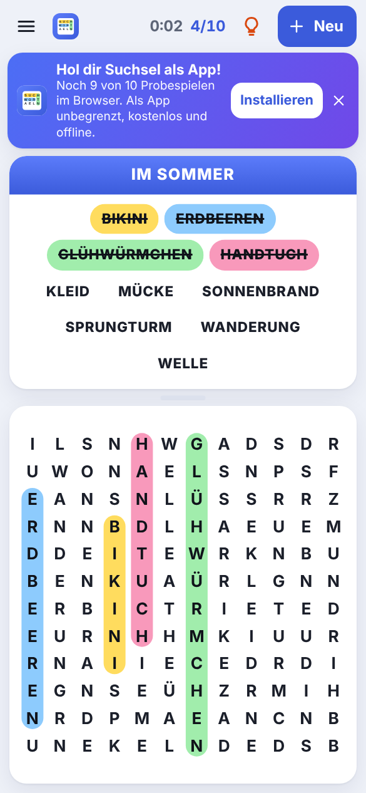
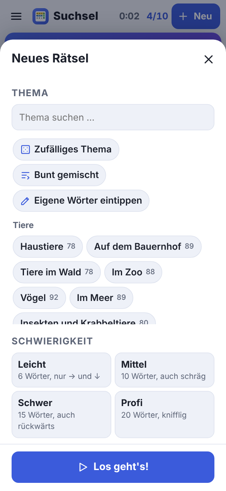
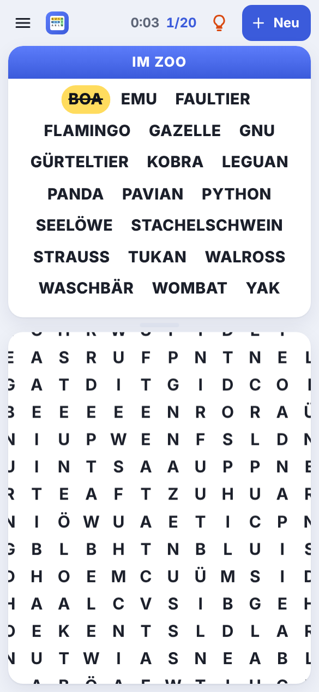
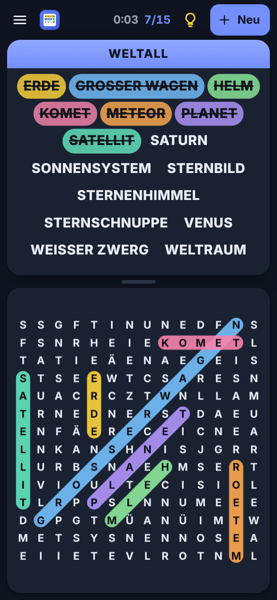
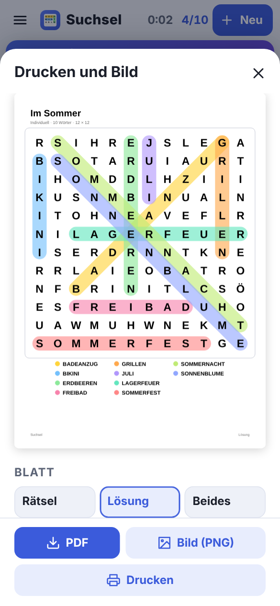
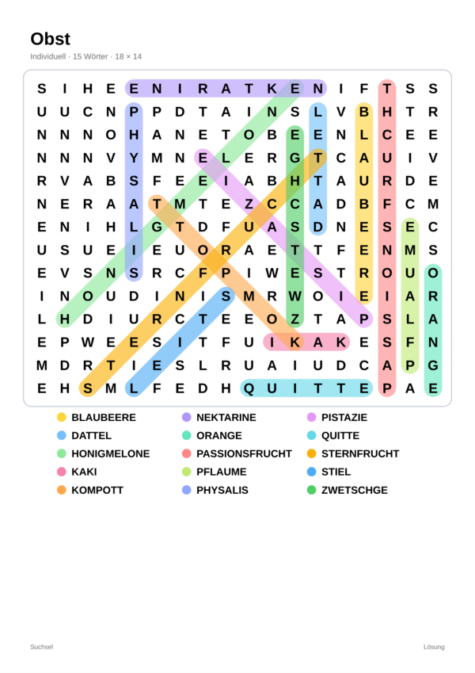
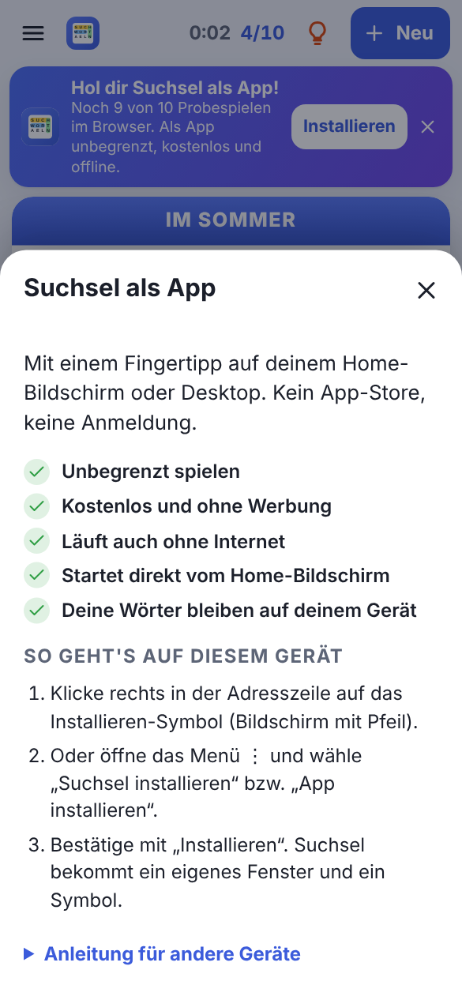
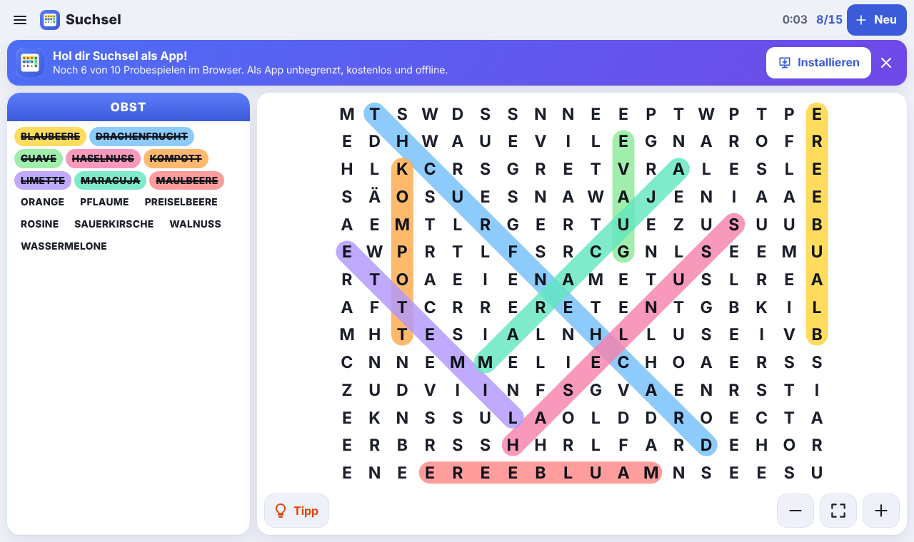

# Suchsel

**Deutsch** · [English](README.en.md)

[](#voraussetzungen)
[](#lizenz)
[](https://ko-fi.com/burnersen)

## 🎮 [Jetzt spielen: suchsel.burnersen.de](https://suchsel.burnersen.de)

**Kostenlos für alle, ohne Anmeldung und ohne Werbung.** Einfach im Browser ausprobieren und bei Gefallen mit einem Klick als App auf Handy, Tablet oder Rechner installieren. Ganz ohne eigenen Webspace.

Wer Suchsel lieber auf dem eigenen Server betreiben möchte, kann das gern tun: **[⬇️ Neuestes Release herunterladen](../../releases/latest)**, siehe [Installation](#installation).

**[☕ Spendier mir einen Kaffee](https://ko-fi.com/burnersen)**

<p align="center">
  <a href="promo/suchsel-promo.mp4"></a><br>
  <sub>🎬 Suchsel in einer Minute · <a href="promo/suchsel-promo.mp4">Video als MP4 zum Teilen</a></sub>
</p>

Wortsuchrätsel als App zum Selbsthosten. Wörter mit dem Finger oder der Maus markieren, groß zoomen, eigene Wörter eintippen und als A4-PDF ausdrucken. Mit über 26.000 Wörtern in sechs Sprachen. Auf dem Server läuft PHP, im Browser schlichtes JavaScript und CSS. Keine Frameworks, keine Abhängigkeiten, kein Build-Schritt, kein MySQL.

Die App wird einmal vom Server geladen und läuft danach komplett auf dem Gerät, auch ohne Internet. Wer die Webseite im Browser öffnet, darf ein paar Rätsel ausprobieren (von Haus aus 10). Danach geht es mit der installierten App kostenlos und unbegrenzt weiter. Ein Hinweis oben auf der Seite lädt bei jedem Besuch dazu ein.

`suchsel-install.php` hochladen, im Browser öffnen, auf „Jetzt installieren“ klicken. Das ist die ganze Installation. Neue Versionen spielt Suchsel danach von selbst ein.

<p align="center">
  
</p>

<table>
  <tr>
    <td align="center" width="33%"><br><sub>Thema und Schwierigkeit wählen</sub></td>
    <td align="center" width="33%"><br><sub>Großes Gitter, mit Zoom</sub></td>
    <td align="center" width="33%"><br><sub>Dunkel und mit runder Schrift</sub></td>
  </tr>
  <tr>
    <td align="center"><br><sub>Drucken mit Vorschau</sub></td>
    <td align="center"><br><sub>Das Lösungsblatt</sub></td>
    <td align="center"><br><sub>Eigene Kategorien</sub></td>
  </tr>
  <tr>
    <td align="center"><br><sub>Anleitung zum Installieren</sub></td>
    <td align="center" colspan="2"><br><sub>Am Rechner: Wortliste links, Gitter rechts</sub></td>
  </tr>
</table>

<sub>Screenshots von Version 1.0.0.</sub>

> 💜 **Gefällt dir Suchsel?** Ein ⭐ auf GitHub ist die einfachste Art, mir das zu sagen. Oder [erzähl mir, wofür du es nutzt](https://github.com/burnersen/suchsel/issues/new), ich lese jede Nachricht. Danke!

## Inhalt

[So geht's](#so-gehts) · [Funktionen](#funktionen) · [Voraussetzungen](#voraussetzungen) · [Installation](#installation) · [Einstellungen auf dem Server](#einstellungen-auf-dem-server) · [Updates](#updates) · [Datenschutz und Sicherheit](#datenschutz-und-sicherheit) · [Aufbau](#aufbau) · [Wortschatz erweitern](#wortschatz-erweitern) · [Gut zu wissen](#gut-zu-wissen) · [Lizenz](#lizenz)

## So geht's

1. **Wörter suchen:** Oben stehen die gesuchten Wörter. Mit dem Finger oder der Maus über die Buchstaben eines Wortes ziehen. Die Markierung rastet waagerecht, senkrecht und schräg ein, egal ob man vorn oder hinten anfängt, und bleibt bei kleinen Wacklern in ihrer Richtung.
2. **Gefunden:** Das Wort bekommt eine eigene Farbe, im Gitter und oben in der Liste, und wird dort durchgestrichen. Sich kreuzende Wörter bleiben gut auseinanderzuhalten. Ein Antippen in der Liste zeigt das Wort noch einmal im Gitter.
3. **Geschafft:** Konfetti, Zeit und Bestzeit. Dann gleich das nächste Rätsel, ein anderes Thema oder das Lösungsblatt drucken.

| Bedienung | Am Handy | Am Rechner |
|---|---|---|
| Wort markieren | mit dem Finger darüberziehen | mit gedrückter Maus darüberziehen |
| Zoomen | zwei Finger auseinander- oder zusammenziehen | Mausrad, Strg + Mausrad, Tasten + und − |
| Verschieben | zwei Finger gemeinsam bewegen | rechte Maustaste gedrückt halten, Mausrad, Pfeiltasten |
| Zurück zur Ausgangsgröße | doppelt tippen | Doppelklick oder Taste 0 |
| Wortliste größer oder kleiner | Balken zwischen Liste und Gitter ziehen, doppelt tippen stellt zurück | dito |
| Wortliste oben, unten, links oder rechts | Menü, Einstellungen, Wortliste | dito |
| Tipp | Glühbirne oben | dito |
| Taschenlampe | Finger übers Gitter ziehen | Maus übers Gitter bewegen |

Beim Markieren am Rand wandert das Gitter von selbst mit, so gehen auch lange Wörter in großen Gittern. Die Aufteilung zwischen Wortliste und Gitter richtet sich von selbst nach der Form des Gitters, die Schrift der Wortliste wird so groß, wie der Platz hergibt. Wird die Liste klein gezogen, schrumpft die Schrift, und die schon gefundenen Wörter rücken zu einem kleinen ✓ zusammen, das sie beim Antippen wieder aufklappt. Halb abgeschnittene Einträge gibt es nicht mehr. Text lässt sich nicht aus Versehen markieren.

## Funktionen

### Rätsel

- **Gitter frei wählbar:** Breite und Höhe getrennt, von 5 bis 100. Kleine Gitter passen ganz auf den Bildschirm, große starten lesbar groß und lassen sich zoomen.
- **Schwierigkeit:** Leicht (6 Wörter, nur → und ↓), Mittel (10 Wörter, auch schräg), Schwer (15 Wörter, auch rückwärts), Profi (20 Wörter in alle Richtungen, mit kniffligen Füllbuchstaben). In der Feineinstellung lässt sich alles einzeln einstellen: 5 bis 20 Wörter, Größe, Richtungen (waagerecht, senkrecht, schräg, rückwärts), knifflige Füllbuchstaben.
- **Wie ein echtes Suchsel:** Wörter kreuzen sich gern, die Füllbuchstaben folgen der Buchstabenhäufigkeit der Sprache. Kein Wort taucht aus Versehen zweimal auf, und kein Wort steckt in einem anderen (also nie „Eis“ zusammen mit „Eisbär“).
- **Umlaute:** Ä, Ö, Ü (und Ñ im Spanischen) bleiben im Gitter stehen, auf Wunsch werden sie zu AE, OE, UE. ß wird immer SS, Akzente fallen weg. Leerzeichen und Bindestriche verschwinden: „Eis am Stiel“ steht als EISAMSTIEL im Gitter und als EIS AM STIEL in der Liste.
- **Neu mischen:** dieselben Wörter, neues Gitter.
- **Tipp:** zeigt, wo eins der Wörter anfängt.
- **Taschenlampe:** beim neuen Rätsel einschaltbar. Das Gitter liegt im Dunkeln, nur rund um Finger oder Maus leuchten die Buchstaben, mit einer Lichtspur, die knapp eine Sekunde nachglüht. Je schwerer, desto kleiner das Licht (Leicht groß, Mittel mittel, Schwer und Profi klein). Gefundene Wörter bleiben sichtbar, ist alles gefunden, geht das Licht an. Bestzeiten mit Taschenlampe zählen extra.
- **Wortliste, wo du willst:** oben, unten, links, rechts oder automatisch (im Hochformat oben, auf breiten Bildschirmen links).
- **Stoppuhr und Statistik:** angefangene und gelöste Rätsel, gefundene Wörter, Tipps, Spielzeit und Bestzeiten je Schwierigkeit. Die Uhr läuft nur, solange das Rätsel zu sehen ist.
- **Spielstand bleibt erhalten:** App zu, App auf, weiter geht's.
- **Teilen per Link:** wer den Link öffnet, bekommt genau dasselbe Gitter. Im Link stehen nur die Wörter und Einstellungen, keine Lösungen.

### Wortschatz

Über 26.000 Wörter, nach Themen geordnet und in Gruppen sortiert (Tiere, Essen und Trinken, Natur, Jahreszeiten und Feste, Mensch, Zuhause, Unterwegs, Welt, Freizeit, Fantasie und Geschichte, Technik):

| Sprache | Themen | Wörter |
|---|---|---|
| Deutsch | 69 | 5.406 |
| English | 69 | 5.522 |
| Français | 53 | 3.858 |
| Español | 53 | 3.844 |
| Italiano | 53 | 3.879 |
| Nederlands | 53 | 4.054 |

- **Suche** über alle Themen, dazu „Zufälliges Thema“ und „Bunt gemischt“ (Wörter aus allen Themen).
- **Sprache der Wörter** lässt sich getrennt von der Sprache der App wählen, etwa zum Sprachenlernen: Oberfläche deutsch, Wörter englisch.
- Nur lateinische Buchstaben, keine fremden Schriftzeichen.

### Eigene Wörter

- **Schnell eintippen:** im Fenster „Neues Rätsel“ eine Überschrift und ein paar Wörter eintippen, mit Komma oder Zeilenumbruch getrennt, fertig. Ideal fürs Tagesthema. Das Gitter wächst von selbst mit, wenn ein Wort zu lang ist.
- **Eigene Kategorien** unter Menü → Meine Wörter anlegen, bearbeiten und löschen. Eine eigene Kategorie mit bis zu 20 Wörtern kommt komplett ins Rätsel, bei mehr wird ausgewählt.
- **Eingebaute Themen ergänzen:** fehlt ein Wort, kommt es dazu, nur auf diesem Gerät.
- **Sicherung als Datei:** eigene Wörter, Einstellungen und Statistik speichern und auf einem anderen Gerät wieder einspielen.

### Drucken und Bild

- **A4 als PDF**, erstellt im Browser, ohne fremde Bibliothek und ohne Netz.
- **Rätselblatt, Lösungsblatt oder beides** (zwei Seiten). Auf dem Lösungsblatt sind alle Wörter bunt markiert, gefundene in ihrer Farbe aus dem Spiel.
- **Hoch- oder Querformat**, eigene Überschrift, Wortliste unter dem Gitter (mit Kästchen zum Abhaken), auf Wunsch eine Zeile für Name und Datum.
- **Vorschau** zeigt genau, was aus dem Drucker kommt, und ändert sich beim Einstellen sofort mit. Antippen macht sie groß.
- **Als Bild (PNG)** in hoher Auflösung, etwa für Messenger oder Arbeitsblätter.
- Am Handy gehen PDF und Bild über „Teilen“ direkt zum Drucker oder in eine App, am Rechner als Download. „Drucken“ öffnet das PDF in einem neuen Tab.
- Bei sehr großen Gittern sagt Suchsel, wie klein die Buchstaben auf dem Blatt werden.

### App und Webseite

- **Als App installierbar** (PWA) auf Handy, Tablet und Rechner, mit eigenem Symbol. Kein App-Store, keine Anmeldung.
- **Einmal laden, dann offline:** ein Service Worker hält die ganze App samt Wortschatz aller Sprachen vor.
- **Hinweis zum Installieren** bei jedem Besuch im Browser, mit dem Stand der Probespiele („Noch 7 von 10 Probespielen“). Ein Klick auf „Installieren“ startet die Installation dort, wo der Browser das kann (Chrome, Edge, Android). Sonst kommt eine Anleitung, passend zum Gerät: iPhone und iPad, Android, Firefox, Safari am Mac und Chrome oder Edge am Rechner.
- **Sperre im Browser:** nach 10 Rätseln (einstellbar) pro Adresse und 30 Tagen ist im Browser Schluss, dann erklärt Suchsel freundlich, wie die App aufs Gerät kommt. Ein angefangenes Rätsel lässt sich noch zu Ende spielen. In der installierten App gibt es keine Grenze, und sie fragt den Server nie.
- **Sechs Sprachen:** Deutsch, Englisch, Französisch, Spanisch, Italienisch und Niederländisch. Die App startet in der Sprache des Geräts.
- **Hell, dunkel oder wie das Gerät**, vier Schriften fürs Gitter (klar, rund, klassisch, Schreibmaschine), auf Wunsch Kästchen im Gitter.
- **Vibration** bei Treffern (abschaltbar), Tastaturbedienung am Rechner.

## Voraussetzungen

- PHP 7.4 oder neuer (empfohlen 8.x).
- Die Erweiterung `pdo_sqlite` für die Sperre nach ein paar Spielen im Browser. Fehlt sie, läuft Suchsel trotzdem, nur ohne Sperre.
- Für Updates von selbst: `curl` oder `allow_url_fopen`, und der Webspace muss ausgehende Verbindungen erlauben.
- **HTTPS.** Ohne HTTPS lässt sich die App nicht installieren und läuft nicht offline.
- Ein Webserver mit PHP. **Apache** und LiteSpeed sperren die internen Ordner von selbst über `.htaccess`. **nginx** braucht zwei Zeilen in der Konfiguration, siehe [Datenschutz und Sicherheit](#datenschutz-und-sicherheit).

## Installation

1. Aus dem [neuesten Release](../../releases/latest) die Datei `suchsel-install.php` herunterladen und in ein Verzeichnis auf dem Webserver kopieren, zum Beispiel `/suchsel/`.
2. PHP muss in dieses Verzeichnis schreiben dürfen (es legt dort `index.php`, den Ordner `app/` und später `data/` an).
3. `suchsel-install.php` im Browser aufrufen und auf „Jetzt installieren“ klicken. Die Datei packt das Programm aus, löscht sich selbst und leitet zu Suchsel weiter. Meldet der Installer, dass er sich nicht löschen konnte, die Datei bitte von Hand löschen.
4. **Prüfen, dass die internen Ordner gesperrt sind:** `https://deine-adresse/suchsel/data/config.php` und `https://deine-adresse/suchsel/app/lib/core.php` aufrufen. Beide müssen „403 Forbidden“ oder „404 Not Found“ zeigen.

Fertig. Konten oder eine Einrichtung gibt es nicht.

**Lieber von Hand?** Im Release liegt auch `suchsel-<Version>.zip`. Entpacken und den Inhalt des Ordners `suchsel/` hochladen, also `index.php`, `LICENSE` **und** den Ordner `app/`.

## Einstellungen auf dem Server

Beim ersten Aufruf legt Suchsel den Ordner `data/` an. Darin steht in `data/config.php` ein zufälliger Schlüssel und der Name der Datenbank. Alles andere hat Standardwerte und lässt sich dort ergänzen:

| Eintrag | Standard | Bedeutung |
|---|---|---|
| `'limit' => 10` | 10 | So viele neue Rätsel darf eine Adresse im Browser starten, danach nur noch als App. `0` schaltet die Sperre ab. |
| `'days' => 30` | 30 | Nach so vielen Tagen fängt die Zählung für eine Adresse von vorn an. |
| `'auto_update' => false` | an | Keine Updates von selbst. |
| `'update_url' => ''` | GitHub | Andere Adresse für Updates, `''` schaltet sie ganz ab. |
| `'ip_header' => 'HTTP_CF_CONNECTING_IP'` | leer | Nur hinter einem Proxy wie Cloudflare: woher die echte Adresse des Besuchers kommt. |

So sieht `data/config.php` zum Beispiel mit 5 Probespielen aus (die beiden ersten Zeilen im `return`-Block stehen schon drin und bleiben, wie sie sind):

```php
return array (
  'secret' => '…',
  'db' => 'su_….sqlite',
  'limit' => 5,
);
```

Vorher eine Kopie anlegen, nachher bei Bedarf zurückholen (per SSH im Verzeichnis von Suchsel):

```sh
# Sicherung der Einstellungen
cp -a data/config.php ~/suchsel-config-$(date +%Y%m%d-%H%M).php

# Bearbeiten
nano data/config.php

# Zurückholen (Namen der Sicherung anpassen)
cp -a ~/suchsel-config-JJJJMMTT-HHMM.php data/config.php
```

Ohne SSH: `data/config.php` per FTP herunterladen, eine Kopie aufheben, bearbeiten und wieder hochladen.

## Updates

**Von selbst:** Suchsel schaut höchstens alle 15 Minuten beim neuesten Release auf GitHub nach, und zwar erst, nachdem eine Seite ausgeliefert ist, damit niemand warten muss. Gibt es eine neue Version, wird der Installer heruntergeladen, per Prüfsumme kontrolliert und eingespielt. Die laufende Version wird vorher in `data/update-prev.txt` gesichert. Ersetzt werden nur die Programmdateien, `data/` bleibt unangetastet. Die Geräte holen sich die neue Version beim nächsten Öffnen und zeigen einen Hinweis zum Neuladen.

Dafür muss PHP die Programmdateien überschreiben dürfen und Verbindungen nach außen aufbauen können. Abschalten mit `'auto_update' => false` in `data/config.php`.

**Von Hand:** den neuen `suchsel-install.php` hochladen und aufrufen.

## Datenschutz und Sicherheit

**Was auf dem Gerät bleibt:** eigene Wörter, Kategorien, Einstellungen, Statistik und das laufende Rätsel. Nichts davon geht an den Server.

**Was der Server speichert:** nur im Browser-Tab, nie in der App, fragt Suchsel vor einem neuen Rätsel nach, ob noch eins frei ist. Gespeichert wird dafür nicht die Adresse, sondern eine Prüfsumme mit geheimem Schlüssel, dazu die Anzahl und zwei Zeitpunkte. Nach 30 Tagen wird der Eintrag gelöscht. Bei IPv6 zählt das /64-Netz, das gehört meist einem einzigen Anschluss. Suchsel setzt keine Cookies und lädt nichts von fremden Servern nach, keine Schriften, keine Skripte, keine Statistik.

**Was nach außen geht:** nur die stündliche Frage an GitHub nach einer neuen Version. Persönliches geht dabei nicht raus.

**Die internen Ordner sperren.** Unter Apache legt Suchsel die nötigen `.htaccess`-Dateien selbst an. Unter **nginx** gehören diese zwei Zeilen in den `server`-Block. Das `^~` sorgt dafür, dass die Sperre Vorrang vor der Regel für `.php`-Dateien hat:

```nginx
# Suchsel liegt hier im Ordner /suchsel/. Liegt es direkt im Hauptverzeichnis, /suchsel weglassen.
location ^~ /suchsel/data/ { deny all; }
location ^~ /suchsel/app/  { deny all; }
```

Vorher die Konfiguration sichern, danach testen und neu laden:

```sh
# Sicherung der Konfiguration (Pfad je nach System, oft /etc/nginx/sites-available/)
sudo cp -a /etc/nginx/sites-available/default /etc/nginx/sites-available/default.bak

# Prüfen und neu laden
sudo nginx -t && sudo systemctl reload nginx

# Falls etwas schiefgeht: zurückholen und neu laden
sudo cp -a /etc/nginx/sites-available/default.bak /etc/nginx/sites-available/default && sudo systemctl reload nginx
```

Danach den Test aus [Installation, Schritt 4](#installation) wiederholen. Suchsel braucht keinen direkten Zugriff auf `app/`, auch CSS, JavaScript und der Wortschatz laufen über `index.php`.

Hinweis für die eigene Datenschutzerklärung: Der Zähler für die Probespiele verarbeitet die IP-Adresse kurz, um die Prüfsumme zu bilden. Wer die Sperre nicht will, schaltet sie mit `'limit' => 0` ab, dann speichert Suchsel gar nichts.

## Aufbau

```
index.php      Einstieg: Dateien ausliefern, Service Worker, Manifest, Zähler für die Probespiele, die Seite
app/lib/       Einstellungen und Kopfzeilen, Sperre im Browser (SQLite), Updates (PHP)
app/views/     die Hauptseite (PHP/HTML)
app/assets/    die App im Browser: Spielablauf und Fenster (app.js), Rätsel bauen (game.js), Gitter auf dem Canvas (board.js),
               PDF und PNG (pdf.js), Übersetzungen (i18n.js), Service Worker, CSS, Symbole
app/words/     der Wortschatz, eine Textdatei pro Sprache
data/          entsteht beim ersten Start: Einstellungen, Zähler, Stand der Updates
tools/         baut die Release-Dateien und prüft Wortschatz und Übersetzungen (nur für die Kommandozeile)
```

## Wortschatz erweitern

Der Wortschatz steht in `app/words/de.txt`, `en.txt` und so weiter, als schlichte Textdatei:

```
== Tiere ==
[haustiere] Haustiere
Hund, Katze, Maus, Hamster, Kaninchen, Meerschweinchen,
Wellensittich, Goldfisch, Schildkröte
```

`== … ==` beginnt eine Gruppe, `[id] Name` ein Thema, darunter folgen die Wörter, mit Komma getrennt, gern über mehrere Zeilen. Wörter unter 3 Buchstaben werden nicht benutzt. Eine neue Sprache bekommt eine eigene Datei, etwa `pt.txt`. Die Oberfläche wird in `app/assets/i18n.js` übersetzt.

Zum Prüfen (doppelte Wörter, fremde Schriftzeichen, fehlende Übersetzungen):

```sh
node tools/check-words.js
node tools/check-i18n.js
```

Release bauen: `php tools/build-release.php` legt `dist/suchsel-install.php` und `dist/suchsel-<Version>.zip` an. Auf GitHub erledigt das die Action „Release“, von Hand gestartet oder beim Pushen eines Tags wie `1.0.1`.

## Gut zu wissen

- **iPhone und iPad:** Installiert wird über Teilen → „Zum Home-Bildschirm“, einen Knopf dafür gibt es in Safari nicht. Die installierte App hat ihren eigenen Speicher, eigene Wörter aus dem Browser-Tab nimmt man per Sicherung mit. Safari räumt Daten von Webseiten, die eine Woche nicht benutzt wurden, von selbst weg, installierte Apps sind davon ausgenommen.
- **Firefox am Rechner** kann Web-Apps nicht überall installieren. Suchsel empfiehlt dann Chrome, Edge oder Safari.
- **Hinter einem Proxy** (etwa Cloudflare) sehen alle Besucher für Suchsel aus wie eine einzige Adresse, dann wären die Probespiele für alle zusammen schnell aufgebraucht. Abhilfe: `'ip_header'` setzen, siehe [Einstellungen](#einstellungen-auf-dem-server).
- **Viele Leute hinter einer Adresse** (Schule, Firma, Pflegeheim, mancher Mobilfunk) teilen sich die Probespiele. Wer Suchsel für eine Gruppe im Browser anbieten will, setzt `'limit'` höher oder auf `0`.
- **Die Sperre ist eine weiche Sperre.** Wer es darauf anlegt, kommt drum herum. Für die allermeisten reicht sie, und die installierte App ist ohnehin bequemer.

## ☕ Unterstützen

Suchsel ist kostenlos und entsteht in meiner Freizeit. Wenn es dir Freude macht und du Danke sagen möchtest, kannst du [ein kleines Trinkgeld bei Ko-fi dalassen](https://ko-fi.com/burnersen). Völlig freiwillig, und in jedem Fall: danke fürs Spielen!

## ⚠️ Haftungsausschluss

Suchsel ist kostenlose Hobby-Software und wird **so, wie es ist, ohne jede Gewähr** bereitgestellt. Es ist mit Sorgfalt gebaut und getestet, die Nutzung erfolgt aber **auf eigene Gefahr**.

Wo diese Anleitung beschreibt, was Suchsel tut, prüft oder nie tut, steht dort, wie es gedacht und gebaut ist, keine Zusage und keine Garantie: Software kann Fehler haben, und Systeme, Dienste und andere Programme verhalten sich nicht immer wie erwartet. Soweit gesetzlich zulässig, haftet der Autor nicht für Schäden oder Datenverlust durch die Nutzung dieser Software. Siehe Abschnitte 15 und 16 der [Lizenz](LICENSE).

## Lizenz

GNU Affero General Public License v3.0, siehe [LICENSE](LICENSE).
